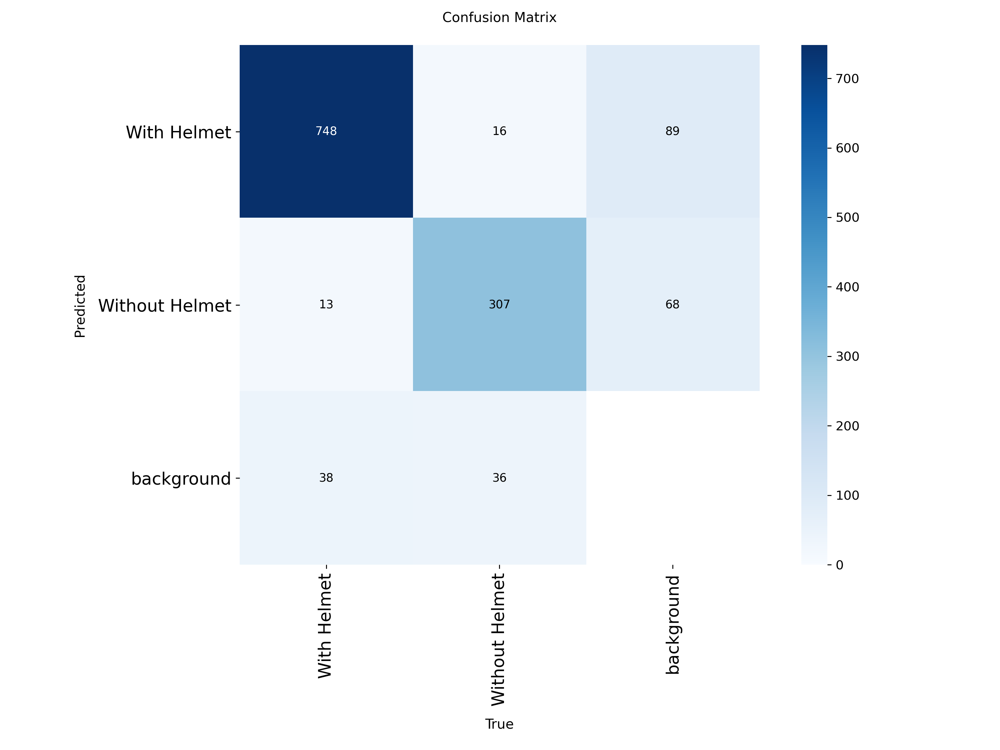
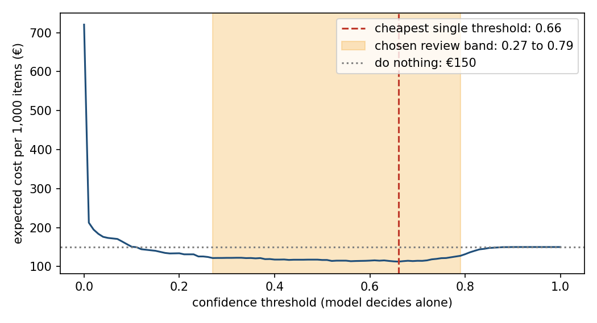

# Assignment 2 Report

- **Name**: Manuela Calle
- **Student ID**: 18754
- **Email**: mcalle.ieu2022@student.ie.edu
- **Group**: BBADBA 5A

## Business problem, and the cost of being wrong

A delivery company wants to stop riders from leaving without a helmet because this is a huge safety risk and it could be a legal liability for the company. A camera at the depot exit photographs each rider (or group of riders), and the model scores each image. Low scores pass automatically, high scores are stopped, and scores in between go to a human reviewer. The decision for each item is pass / review / fail.

The two kinds of error are asymmetric.  The costs are allocated considering a percentage of likelihood of the event actually happening since it doesn't always happen, and then the cost of it actually happening. A false negative (a rider without a helmet is let through) costs about **€5.00** per item: an expected fine of €2.00 (1% chance of a roadside inspection × €200 fine); plus an expected accident cost of €3.00 (0.02% chance of an accident on the trip × €15,000 cost to the company in sick pay, insurance and liability). A false positive (a rider with a helmet is stopped anyway) costs about **€0.65**: €0.40 of rider time (1 minute × €0.40/min) plus €0.25 of expected delivery-delay compensation (5% chance × €5).

A missed violation is around 8× worse than a false alarm. This means the threshold should lean toward catching violations (false positives are less costly than a false negative), and recall on "Without Helmet" matters more than overall accuracy.

All of these figures are just assumptions.

*Addition:* The 8x figure is the headline asymmetry, but it is not the ratio that drives the threshold.
Stopping a real violation is not free: a true positive still costs €3.00 (€2.00 from rider time, €1.00 from delay risk [20% chance of a late delivery x €5]). So catching a violation only saves €2.00 versus missing it (5.00 - 3.00), and the ratio that matters is 2.00 / 0.65, about 3 to 1. An item is worth flagging once the chance it is a violation passes 0.65 / (0.65 + 2.00), about 25%.

## Dataset

- **Source**: Roboflow Universe, workspace `a-yvlja`, project `helmet-and-non-helmet-abb47`, version 1.
- **Link**: https://universe.roboflow.com/a-yvlja/helmet-and-non-helmet-abb47
- **One image** represents one check of a rider or group of riders.
- **Classes**: "With Helmet" and "Without Helmet". An item is a violation if it contains at least one "Without Helmet" detection.
- **Why it fits the problem**: It fits because it serves well for training a model of riders without or with helmets, even when they are in groups on the same bike (although this would not regularly be the case in delivery as they would go alone). A person manually checking all the drivers implies at least a minimum wage (depending on the country this can vary), checking at all times if the drivers are going out with or without a helmet. Additionally, if there are 10 drivers going out at the same time, the person might miss or misclassify accidentally. We assume the model performs better than the human because of the speed and expected precision of the prediction.

## What the dataset's composition implies

| Split | Images | With Helmet (images · boxes) | Without Helmet (images · boxes) |
|---|---:|---:|---:|
| Train | 12,699 | 9,519 · 15,938 | 4,914 · 8,454 |
| Validation | 978 | 717 · 1,154 | 406 · 679 |
| Test | 711 | 563 · 799 | 248 · 359 |

Typical object size relative to the picture ranges a lot. There are images where you can literally only see the head with the helmet and there are images where one helmet is 1/20th of the image because there are also multiple helmets. This is good in terms of how well the model will train.

From `dataset_stats.json`, the median head box in the test split is about 1.1% of the image area for both classes, roughly a tenth of the image width, so most targets are small. The 90th percentile is 8.3% for With Helmet and 2.8% for Without Helmet. Train has a bigger tail for With Helmet (90th percentile 24.2%), meaning close-ups that the test split barely contains.

- "Without Helmet" is the smaller class in every split, and the test split has only 248 images and 359 boxes for it. Each image is worth about 0.4 points of recall, so a few images moving changes recall visibly. Anything finer than class level (small riders only, night only) would rest on a few dozen images.
- The images do resemble the images that the security camera would capture. 
- Precision measured on the test split will overstate what I'd see in production, because violations are more common in the test data than they'd probably be at the real checkpoint.

## Finetuning and baselines

- **Model and task**: YOLO11n object detection, finetuned from the COCO checkpoint. **Detection** rather than whole-image classification because the labels are boxes, images can hold several riders, and a box shows the reviewer which rider triggered the flag. Nano size because it is fast and enough to show the pipeline.
- **Settings**: 15 epochs, early stopping patience 15, image size 640, batch 16, seed 0, deterministic. Trained on a GPU, per `run.json`. With 15 epochs and patience 15, early stopping could never trigger.
- **Item score**: the highest confidence the model gives any "Without Helmet" box in the image (0 if none).

| Model | Precision | Recall | Notes |
|---|---|---|---|
| Finetuned model | 0.907 | 0.948 | Item level, conf 0.25, same 711 test images. Accuracy 0.948, ROC AUC 0.977 |
| Pretrained COCO model, zero-shot | 0.369 | 0.875 | No helmet class in COCO, so it can only say "a person is here". Accuracy 0.435, ROC AUC 0.568 |
| Trivial baseline (always predict "With Helmet") | n/a | 0.00 | Accuracy 0.651 (463 of 711 items are compliant) while catching nothing |

The finetuned model catches 235 of 248 violation images and raises 24 false alarms on 463 compliant images. Zero-shot COCO has a recall of 87.5%, but only because it flags almost everything: 371 of the 463 compliant images get flagged, so its precision (36.9%) is essentially the 34.9% base rate, which is what flagging at random would give. Its accuracy (43.5%) is below the trivial "pass everything" baseline (65.1%), and its AUC (0.568) is barely above chance. The trivial baseline's 65.1% accuracy is also why accuracy is the wrong headline metric here: it looks decent while catching zero violations. Finetuning is what turns "a person is present" into "this person has no helmet".

## Per-class evaluation and failure modes

Box-level results on the test split (precision and recall at the confidence that maximises F1):

| Class | Test images | Boxes | Precision | Recall | AP50 | mAP50-95 |
|---|---:|---:|---:|---:|---:|---:|
| With Helmet | 563 | 799 | 0.930 | 0.915 | 0.953 | 0.640 |
| Without Helmet | 248 | 359 | 0.846 | 0.819 | 0.874 | 0.536 |
| All classes | 711 | 1,158 | 0.888 | 0.867 | 0.913 | 0.588 |

Box-level confusion matrix at confidence 0.25 (rows are what the model predicted, columns are the truth):

| Predicted / True | With Helmet | Without Helmet | Background |
|---|---:|---:|---:|
| With Helmet | 748 | 16 | 89 |
| Without Helmet | 13 | 307 | 68 |
| Background (nothing found) | 38 | 36 | n/a |

The model is better at spotting helmets than at spotting missing helmets, and the missing-helmet class is the one the business cares about.
 
| Class | Precision | Recall |
|---|---:|---:|
| With Helmet | 0.93 | 0.92 |
| Without Helmet | 0.85 | 0.82 |
 
Precision is how often a box the model draws is right. Recall is how many of the real heads it finds. These are per head, not per image.
  
- **Stronger class**: With Helmet. It has about twice as many training examples.
- **Weaker class**: Without Helmet. It finds about 82% of the heads without helmets.
- **What it gets confused with**: The model almost never mixes up the two classes. Its mistakes are mostly heads it misses completely, or boxes it draws where there is no head. So the main difficulty is finding heads, not deciding whether they wear a helmet.
- **Where it breaks**: Per image, the model misses 13 of the 248 images with a violation and wrongly flags 24 of the 463 compliant images. 9 of the 13 misses also show a rider with a helmet, so it may struggle when a rider without a helmet stands next to riders with helmets. That is a small number, so it is something to check, not a finding.
## Cost matrix and operating point
 
| Outcome | Cost (€ per item) | Source |
|---|---|---|
| False negative | 5.00 | Fine: 1% × €200 = €2.00. Accident: 0.02% × €15,000 = €3.00. Both assumed. |
| False positive | 0.65 | Rider time: 1 min × €0.40/min = €0.40. Delay: 5% × €5 = €0.25. Assumed. |
| True positive | 3.00 | Time to fetch and put on a helmet: 5 min × €0.40/min = €2.00. Delay: 20% × €5 = €1.00. Assumed. |
| True negative | 0.00 | No intervention, no delay. |
 
- **Base rate assumed**: 3% of riders leave without a helmet.
- **Review cost**: a person looking at one image for 10 seconds at €20/hour costs about €0.056, which is much cheaper than a mistake. That is why the design has a middle zone where the model is unsure and a person decides.
- **Choosing the thresholds**: I tried many pairs of cut-offs and kept the one with the lowest expected cost. The model's score is not a true probability, so the cut-offs have to come from this search.

 
- **Operating point chosen**: pass below **0.27**, fail at or above **0.79**, and send everything in between to a person. About 6 of every 100 items go to a person.
- **Assumption that would most change my answer**: The accident cost (0.02% × €15,000 = €3.00). It makes up 60% of the false-negative cost, so if it were much lower, fewer riders would need to be stopped. I reran the search with the accident cost halved and doubled. The upper cut-off stayed at 0.79 and the lower one only moved a little, so the design is not very sensitive to this assumption.
## What a person still has to check
 
- **Thresholds**: pass below 0.27, fail at or above 0.79, review in between.
- **Share of cases sent to a person**: about 6% of items.
- **Per day**: 6% × 1,500 items/day = about 92 items.
- **Time per check**: 10 seconds.
- **People needed**: 92 × 10 seconds is about 15 minutes a day, so a small fraction of one person.
- **Is that realistic?** Yes for workload: it is a small task for someone already at the depot, not a full job. The harder parts are speed and accuracy. A rider waits at the exit while the image is reviewed, so the person has to answer within seconds, and the costing assumes they are always right.
Baseline alternatives, at 1,500 items/day and a 3% base rate (review costs 10 s at €20/h ≈ €0.056 per item):
 
| Alternative | Cost per day | Working |
|---|---|---|
| Do nothing | €225 | 1,500 × 0.03 × €5.00 (every violation is a false negative) |
| Person checks everything | ≈ €218 | 1,500 × (€0.056 + 0.03 × €3.00); about 4.2 hours of review, so under one person |
| Perfect model, no review (lower bound) | €135 | 1,500 × 0.03 × €3.00 |
| Model decides on its own | about €169 | One cut-off at 0.66 |
| Model + review band (my design) | about €145 | Cut-offs at 0.27 and 0.79, about 92 reviews a day |
 
Under these assumptions, having a person check everything barely beats doing nothing, so the value of the model depends heavily on the cost assumptions. *Addition:* My design costs about €145 a day, about €80 less than doing nothing. Even a perfect model could only save about €90 a day, so the design gets most of what is possible. This is a little optimistic, because I chose the cut-offs using the same images I measured on.
 
## Limitations & next steps
 
- **Assumed costs and base rate**: Every euro figure and the 3% rate are my assumptions. I would replace them with the company's real fines, incident and claims history, and a count of riders without helmets from a week of depot footage, then rerun the analysis.
- **Thresholds tuned on the test set**: I chose the cut-offs and measured the cost on the same images, so the result is a bit too good. I would choose them on the validation set and test once at the end. The test set also has only 248 violation images, so the recall figures are uncertain.
- **Short training run**: The model trained for only 15 epochs, so early stopping could not stop it. I did not check whether it was still improving. I would train longer and look at the validation curve first.
- **One score per image**: A single wrong box can flag a whole group image, and a missed head in a group can let it pass. I would look at group images separately and consider scoring each rider.
- **Missing some heads**“ The model sometimes misses heads entirely, about 1 in 10 for riders without a helmet, rather than misclassifying them. When the missed head is the only violation in the image, the cost is counted as a false negative, which is fine. However, when another rider in the same image is detected, the image is flagged and the missed rider is not counted, so the cost is understated for group images.

## Generative AI use disclosure

I have used AI to help me in the creation of the code in its entirety. However, I have written the report and have reviewed the code myself. 
